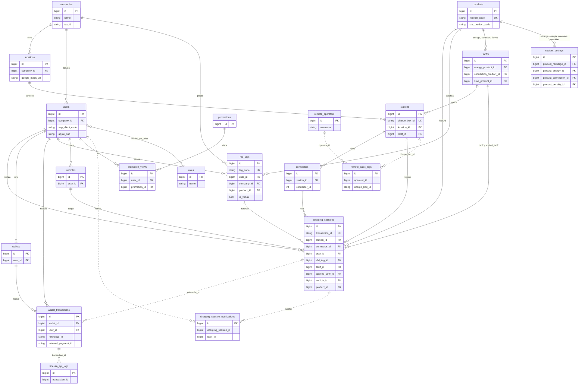

# Diagrama entidad-relación (tablas propias del CMS)

Generado a partir de `database/migrations` y las relaciones de `app/Models`.
No incluye las tablas de SteVe ni las internas de Laravel (`cache`, `jobs`, `sessions`,
`personal_access_tokens`, `activity_log`) ni las de permisos de Spatie, salvo `roles`.

- Línea continua (`--`): FK real definida en la migración.
- Línea punteada (`..`): relación lógica, sin FK en la base de datos.

## Vínculos con SteVe

| Columna del CMS | Equivale en SteVe |
|---|---|
| `stations.charge_box_id` | ID del cargador (`charge_box`) |
| `charging_sessions.transaction_id` | ID de la transacción (`transaction_pk`); el modelo carga las lecturas del medidor por esta columna |
| `rfid_tags.tag_code` | Tarjeta OCPP (`ocpp_tag`) |

## Puntos a revisar

- `wallet_transactions.reference_id` es un string que apunta a `charging_sessions.transaction_id`,
  pero también guarda la referencia de Libélula: una misma columna con dos significados.
- `charging_session_notifications`, `libelula_api_logs` y `remote_audit_logs` guardan IDs sin FK;
  si se borra el registro al que apuntan, quedan huérfanos.
- `wallet_transactions.user_id` aparece en tres migraciones con reglas distintas al borrar el usuario
  (`2026_02_09` y `2026_03_31` con `cascade`, `2026_03_30` con `nullOnDelete`); conviene confirmar
  qué regla quedó en producción.
